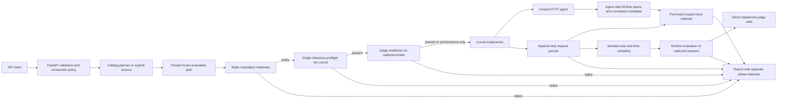

# EvalSurge architecture

The current milestone is a reproducible single-run benchmark with durable partial records, correlated framework traces, a bounded visual report, and representative quality sampling. Shared hosting and capacity discovery remain separate release gates.

Direct Python execution is the onboarding default. `EvalSurge(...)` binds
operator-owned `Agent.http(...)` or `Agent.databricks_app(...)` targets outside
the v2 `RunCreate`; `EvalSurge.remote(..., typed=True)` submits that same request
to an optional API host. New handles share typed status/result/report/cancel
contracts. Legacy local keyword calls, dictionary-returning remote calls and
`/v1` remain compatible. See [ADR 0011](docs/adr/0011-unified-direct-and-remote-sdk.md)
and [the Python guide](docs/PYTHON_API.md). Maintainer review and new live journey
validation remain separate gates, not claims established by schema checks.

The additive `/v2` façade selects registered targets and defaults evaluation to off.
Registered targets can be ordinary HTTP endpoints (including runner-local agents)
or deployed Databricks Apps. Hosting/discovery and invocation protocol are separate:
both share the coordinator and sole Locust engine. See [target contracts](docs/TARGETS.md).
It admits before asynchronous planning, then shares the same preflights, Locust,
captured-answer evaluation, and evidence storage. Operator settings use private
task-local snapshots; App discovery, OAuth, and synchronous invocation wire handling
remain separate from load execution. See [the v2 guide](docs/V2_API.md) and
[ADR 0009](docs/adr/0009-v2-databricks-app-boundaries.md). Lifecycle/retention and
capacity campaigns in that ADR remain deferred.

The minimal hosted-agent onboarding contract is documented in
[the framework-neutral integration recipe](docs/AGENT_INTEGRATION.md).
[Proposed ADR 0012](docs/adr/0012-hosted-agent-integration-contract.md) separates
hosting/authentication, invocation and trace evidence. Its optional agent-side
`evalsurge.serving` helper adapts a customer-owned async handler to `http-json`
with explicit request/case/run-shared state keys. V2 results distinguish configured
from observed evidence without new collection calls. No new load backend,
capacity discovery, automatic instrumentation or legacy protocol removal is
implemented. Maintainer review and live journey validation remain separate gates.

## Responsibility boundaries

- `api.py`: REST authorization, validation, response metadata, safe HTTP errors, and presentation over the shared coordinator.
- `coordinator.py`: single-owner storage, admission, idempotency/recovery, frozen plans, task/phase transitions, paginated results, cancellation, and drain.
- `evalsurge/`: default sync/native-async direct v2 facade and optional typed remote adapter; legacy interfaces remain, with one coordinator/Locust engine and explicit operator target bindings.
- `run_views.py`: FastAPI-independent typed status/result/report presentation shared by direct execution and v2 routes; no new evaluator or worker.
- `evalsurge/serving.py`: optional agent-process HTTP endpoint over a customer-owned handler; input/completion validation and untrusted correlation/state keys, not agent auth, memory or automatic tracing.
- `validation.py`: bounded value-free request diagnostics shared by REST, SDK and CLI; schema errors remain distinct from JSON-encoding errors.
- `connections.py`: operator-owned credential references bound to exact target URLs. API callers cannot select arbitrary environment secrets.
- `planner.py`: bounded optional LLM selection from catalog IDs and operator-allowlisted aliases, using opt-in manifests. Deterministic validation decides readiness. The model cannot change load limits, destinations, credentials, rubric implementations, or evidence requirements.
- `models.py`: strict request contracts with unknown fields rejected and bounded workloads.
- `locust_runner.py`: single-request inference preflight through the same engine, subprocess isolation, cancellation, outer deadline, durable artifact directories, partial recovery.
- `locustfile.py`: sequential users, round-robin cases, protected authentication/request lifecycle, bounded streams, per-request measurement.
- `streaming.py`: shared event semantics for OpenAI Chat Completions and Responses-style SSE. Supported adapters expect JSON in single-line `data:` events. `[DONE]`, a normal chat finish followed by EOF, or `response.completed` terminates a response. Missing terminal events, filtered/truncated output, invalid JSON, empty output, and deadlines are failures.
- `runner.py`: payload construction and descriptive metrics only. There is no alternate async load engine.
- `adapters.py`: bounded supported wire decoding, including the explicit `http-json` contract; JSON TTFT/first-event timing is unavailable.
- `storage.py`: fsync'd request events, atomic snapshots, and recovery of interrupted attempts. A killed writer's incomplete final line is ignored.
- `sampling.py`: fixed-seed randomized case/time strata over the observed dispatch window. The seed reproduces selection from identical records; it does not make model responses deterministic.
- `evaluation_preflight.py`: validates frozen setup and checks one captured probe assessment per criterion before load, with no target reinvocation.
- `evaluator.py` / `judges.py`: score captured answers through native MLflow, preserve assessment coverage/errors, and call Databricks directly using MLflow-shipped rubrics. Readiness is tagged separately from post-load quality; provider failures become content-free native assessment errors without extra MLflow retry layering.
- `evaluation_details.py`: request-tag correlation and bounded per-assessment quality explanations. Judge rationales are protected content, separate from sanitized profiling and fixed safe execution diagnostics; see ADR 0008.
- `scorer_registry.py`: exact-version trusted scorer resolution, public serialization hashes, and frozen operator-owned MLflow/trace scope.
- `profiling.py`: post-load correlation validation, bounded content-free normalization, union-based self time, wall occupancy with explicit parallel work, and descriptive per-name hotspots.
- `middleware.py`: incremental body-size enforcement, including chunked HTTP.
- `static/`: same-origin report shell; it carries no credentials or embedded run data and uses authenticated JSON.
- `docs_ui/`: public self-hosted Swagger UI with pinned upstream assets and external
  initialization; no CDN or inline-script exception to the global CSP.

## State and evidence

Hosted-target payloads remain model/provider independent within their documented
wire adapters; optional token-usage requests can be disabled explicitly. Demo
reasoning presets are exact provider/model matches and never injected by Locust.
Planning and catalog-judging provider coverage are separate, narrower contracts.
See [ADR 0002](docs/adr/0002-model-compatibility-boundaries.md) and the
[support matrix](docs/MODEL_COMPATIBILITY.md); no automatic parameter/model fallback
or target retry is introduced.

A run persists its config and frozen plan before load. The plan records the model endpoint, workspace/profile, installed rubric hash, dataset and policy hashes, sampling settings, maximum responses per scorer, judge output-token limit, timeout, and retry cap. Reusing a plan rejects changed evaluation inputs. Rubric drift is checked before judging. Endpoint names are not immutable model versions; the operator must pin a served revision where supported.

The overall state progresses `queued → preflighting → running → profiling → evaluating → completed | completed_with_gaps`. Static setup, first-case inference, and selected-judge readiness must pass before measured load. Failure exposes safe corrective guidance and a readable report with no measured rows. The extra probe can execute tools/incur cost; its captured answer is reused for readiness but excluded from benchmark metrics, profiles, and quality results. Historical checks use `not_run`; performance-only skips judge readiness. See [ADR 0006](docs/adr/0006-evaluation-readiness.md).

Load failure, cancellation, or interruption terminates separately and skips evaluation. Profiling still exposes partial observations when available. `preflight`, `evaluation_preflight`, `load_status`, `load_error`, `profiling_status`, and `evaluation_status` are retained independently. Evaluation or trace-collection failure never discards measurements. A quality score of zero is a valid completed assessment, not a transport failure.

Per-attempt journals record starts before authentication and flush completions in the request cleanup path. Authentication exceptions decrement active counts and become infrastructure failures. HTTP in-flight counters exclude authentication. A worker kill recovers completed rows, marks remaining starts interrupted, and marks aggregate completeness false. Interrupted-run rates use parent-observed elapsed time and are diagnostic, not comparable benchmark results. In-memory job ownership is not resumed after restart.

The process lock enforces one coordinator owner on local POSIX storage. Compact summaries feed a history/idempotency index; durably finished payloads are evicted from memory. Startup rebuilds metadata from authoritative snapshots once, because snapshot/summary writes are not a transaction. Persistence failures stop new admission and may retain a warned in-process terminal receipt that can be lost on restart. Persisted active phases read as interrupted, including idempotency replay. Restart recovery requests cancellation of abandoned preflight/load workers. There is no automatic retry of agent traffic: retries can duplicate external actions and distort metrics. A future distributed implementation needs a durable queue, leases with fencing, heartbeat recovery, explicit retry semantics, and transactional admission/idempotency.

## Measurement contract

This is closed-loop load. Each Locust user waits for its response before sending another. As response times rise, achieved request rate falls. The workload cannot infer maximum sustainable throughput from one concurrency level. See [Locust's task and pacing documentation](https://docs.locust.io/en/stable/writing-a-locustfile.html).

For REST runs, the API host is the load generator: `locust_runner.py` starts one local Locust subprocess, which sends the target requests and writes the journal. API clients may be remote, but moving the client does not change the measurement vantage point. Local Python runs start Locust on the Python caller's machine instead. Runner CPU, memory, sockets, network, and journal disk I/O can constrain the observation; this milestone does not capture runner saturation metrics. Place the runner separately from the target and record its resources and network location. See [deployment guidance](docs/USAGE.md#where-to-run-evalsurge).

The measured run window starts at Locust test start and includes user ramp-up, authentication, journaling, and drain. Preflight, subprocess startup, planning, and judging are outside that window. Per-request TTFT and latency start just before HTTP dispatch, after auth. TTFT means first nonempty user-visible answer-text delta received at this client; it does not measure first response byte or browser paint. Apart from the separate first-case probe, warmup is not excluded in this milestone.

Quality sampling stratifies on case and request-start time, not completion order. Successful captured outputs are eligible; correctness further requires references. Failed-request counts and eligible/selected/scored coverage accompany scores. Balancing deliberately changes the sample distribution; scorer means are not unbiased population estimates or confidence intervals.

## Instrumentation and latency attribution

Endpoint-only measurements observe a client envelope and optionally a returned MLflow trace ID. They cannot reconstruct remote retrieval, tool, orchestration, queueing, or LLM spans. Auto-enabling MLflow requires changes inside the hosted agent process or existing trace export, plus correlation IDs.

The real framework demos attach run/request IDs to server traces and emit a trace-ID metadata event before answer text. The collector validates exact metadata and experiment membership, then excludes trace contents from report artifacts. Actual Trace objects remain in memory for trace-aware native evaluation only. Each attempt has a separately persisted profile; the report reads at most 100 profiles per page.

Self time subtracts the union of direct-child intervals. A sweep partitions root wall time by the deepest active leaves; multiple concurrent leaves occupy an explicit parallel bucket. Inclusive per-name p95 highlights observed slow spans, not proven causal bottlenecks. Agent-relative timestamps cannot locate residual client time on a network/server timeline. Missing traces, invalid trees, scope mismatches, and collection budgets remain visible gaps.

Bounds: one active run, 100 concurrent users, 10,000 attempts, 1,000 workload cases, 8 MB request bodies, three planner input previews, 20 disclosed capability previews, at most 200 fetched traces, and bounded spans per trace. At the default 100 traces × 250 spans, normalization/report complexity is bounded independently of the full request journal. This optimizes local simplicity and deterministic evidence over horizontal scale; large journals/history still need indexed external storage and retention.

## Next milestones

The quality-first report and documentation delivery decisions are recorded in
[ADR 0003](docs/adr/0003-self-hosted-docs-quality-first-report.md). Judge suggestions
and assessment results remain separate evidence. A reversible focused waterfall
view hides enclosing spans for readability without changing persisted spans,
occupancy calculations, or hotspot summaries.

The shared coordinator, Python facade, and JSON transport are recorded in
[ADR 0005](docs/adr/0005-shared-coordinator-python-json.md). Local Python runs Locust
on the caller's machine; REST runs it on the API host. Both still require exclusive
ownership of the artifact directory.

1. Capacity discovery: concurrency stages, excluded warmup, repeated measurement windows, explicit latency/error/quality thresholds, and generator saturation checks.
2. Harden framework integrations for deployment, add the catalog retrieval-groundedness wrapper, and calibrate trace-aware quality criteria.
3. Calibrate judges with labeled positive and negative cases; support reviewed custom rubrics and preserve rubric lineage.
4. Shared deployment: durable queue/database, workers with leases, per-tenant connection ACLs, egress control, quotas, bounded retention, and provider spend accounting.

Public API conventions follow [FastAPI's modular application guidance](https://fastapi.tiangolo.com/tutorial/bigger-applications/) and packaging metadata follows [PyPA's pyproject guide](https://packaging.python.org/en/latest/guides/writing-pyproject-toml/). Automated schema review results and accepted local-alpha limitations are recorded in `docs/API_REVIEW.md`.
