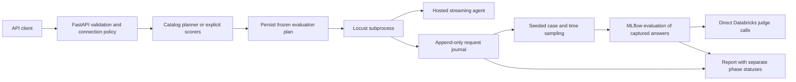

# EvalSurge architecture

The current milestone is a reproducible single-run benchmark with durable partial records and representative quality sampling. Capacity discovery and internal trace attribution are separate future capabilities.

## Responsibility boundaries

- `api.py`: application factory, admission control, authorization, idempotency, phase transitions, persisted plans, paginated results, safe HTTP errors.
- `connections.py`: operator-owned credential references bound to exact target URLs. API callers cannot select arbitrary environment secrets.
- `planner.py`: optional LLM selection from four scorer IDs. Deterministic validation decides readiness. The model cannot change load limits, destinations, credentials, rubric implementations, or evidence requirements.
- `models.py`: strict request contracts with unknown fields rejected and bounded workloads.
- `locust_runner.py`: subprocess isolation, cancellation, outer deadline, durable artifact directory, partial recovery.
- `locustfile.py`: sequential users, round-robin cases, protected authentication/request lifecycle, bounded streams, per-request measurement.
- `streaming.py`: shared event semantics for OpenAI Chat Completions and Responses-style SSE. Supported adapters expect JSON in single-line `data:` events. `[DONE]`, a normal chat finish followed by EOF, or `response.completed` terminates a response. Missing terminal events, filtered/truncated output, invalid JSON, empty output, and deadlines are failures.
- `runner.py`: payload construction and descriptive metrics only. There is no alternate async load engine.
- `storage.py`: fsync'd request events, atomic snapshots, and recovery of interrupted attempts. A killed writer's incomplete final line is ignored.
- `sampling.py`: fixed-seed randomized case/time strata over the observed dispatch window. The seed reproduces selection from identical records; it does not make model responses deterministic.
- `evaluator.py` / `judges.py`: evaluate captured answers after load, preserve assessment coverage/errors, and call Databricks directly using MLflow-shipped rubrics. MLflow stores evaluation runs and assessments locally by default; inference uses the configured workspace.

## State and evidence

A run persists its config and frozen plan before load. The plan records the model endpoint, workspace/profile, installed rubric hash, dataset and policy hashes, sampling settings, maximum responses per scorer, judge output-token limit, timeout, and retry cap. Reusing a plan rejects changed evaluation inputs. Rubric drift is checked before judging. Endpoint names are not immutable model versions; the operator must pin a served revision where supported.

The overall state progresses `queued → running → evaluating → completed | completed_with_gaps`. Load failure, cancellation, or interruption terminates separately and skips evaluation. `load_status` and `evaluation_status` are retained independently. Evaluation failure never discards measurements. A quality score of zero is a valid completed assessment, not a transport failure.

Per-attempt journals record starts before authentication and flush completions in the request cleanup path. Authentication exceptions decrement active counts and become infrastructure failures. HTTP in-flight counters exclude authentication. A worker kill recovers completed rows, marks remaining starts interrupted, and marks aggregate completeness false. Interrupted-run rates use parent-observed elapsed time and are diagnostic, not comparable benchmark results. In-memory job ownership is not resumed after restart.

The process lock enforces one API owner on local POSIX storage. Restart recovery requests cancellation of abandoned load. There is no automatic retry of agent traffic: retries can duplicate external actions and distort metrics. A future distributed implementation needs a durable queue, leases with fencing, heartbeat recovery, explicit retry semantics, and transactional admission/idempotency.

## Measurement contract

This is closed-loop load. Each Locust user waits for its response before sending another. As response times rise, achieved request rate falls. The workload cannot infer maximum sustainable throughput from one concurrency level. See [Locust's task and pacing documentation](https://docs.locust.io/en/stable/writing-a-locustfile.html).

The measured run window starts at Locust test start and includes user ramp-up, authentication, journaling, and drain. Subprocess startup, planning, and judging are outside that window. Per-request TTFT and latency start just before HTTP dispatch, after auth. TTFT means first nonempty user-visible answer-text delta received at this client; it does not measure first response byte or browser paint. Warmup is not excluded in this milestone.

Quality sampling stratifies on case and request-start time, not completion order. Successful captured outputs are eligible; correctness further requires references. Failed-request counts and eligible/selected/scored coverage accompany scores. Balancing deliberately changes the sample distribution; scorer means are not unbiased population estimates or confidence intervals.

## Instrumentation and latency attribution

Endpoint-only measurements observe a client envelope and optionally a returned MLflow trace ID. They cannot reconstruct remote retrieval, tool, orchestration, queueing, or LLM spans. Auto-enabling MLflow requires changes inside the hosted agent process or existing trace export, plus correlation IDs.

A later LangGraph/OpenAI Agents instrumentation package should attach run/request IDs to server traces and ingest them separately from the load journal. The latency visualization should distinguish wall-clock critical path from summed span duration, account for overlapping spans, and report unobserved time. It should not attribute network residuals to a specific server component without evidence.

## Next milestones

1. Capacity discovery: concurrency stages, excluded warmup, repeated measurement windows, explicit latency/error/quality thresholds, and generator saturation checks.
2. Framework instrumentation and trace correlation, followed by latency visualization and retrieval-groundedness evaluation.
3. Calibrate judges with labeled positive and negative cases; support reviewed custom rubrics and preserve rubric lineage.
4. Shared deployment: durable queue/database, workers with leases, per-tenant connection ACLs, egress control, quotas, bounded retention, and provider spend accounting.

Public API conventions follow [FastAPI's modular application guidance](https://fastapi.tiangolo.com/tutorial/bigger-applications/) and packaging metadata follows [PyPA's pyproject guide](https://packaging.python.org/en/latest/guides/writing-pyproject-toml/). Automated schema review results and accepted local-alpha limitations are recorded in `docs/API_REVIEW.md`.
