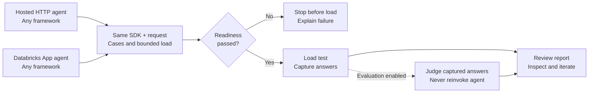

# EvalSurge: product and customer journey

October 12, 2026 · Current implementation and proposed direction

## Purpose

**Bring any hosted agent, provide test cases, and measure its performance and
answer quality through one API.** LangGraph, OpenAI Agents, CrewAI, and custom
implementations share the endpoint boundary. EvalSurge does not build or deploy
agents. Customers need not know supported concurrency beforehand; testing it is
the point.

## Design: one SDK, two target bindings

Direct Python generates traffic from the customer's machine; no EvalSurge server
is required. Target a separately running HTTP agent or deployed Databricks App.

`RunCreate` contains a target alias, cases (`input`/`reference`), load limits, and
evaluation policy. URLs, credentials, and explicitly selected profiles stay in
operator bindings. Optional remote SDK or `/v2` REST execution uses the same
request but generates traffic from the API host. `/v1` remains compatible. All
paths reuse one coordinator and Locust engine at one closed-loop concurrency level.

## Customer journey



Local execution shown: traffic comes from your machine. Evaluation defaults off;
optional agent-side MLflow traces add internal profiling and trace-aware evidence.

1. **Bring a reachable agent.** For generic HTTP, expose a POST endpoint accepting
   the case's JSON unchanged and returning `{"outputs": "completed answer"}`.
   For Apps, deploy a compatible DurableAgentServer `/api/invocations` endpoint.
   Supported streaming contracts need no wrapper; otherwise use a thin wrapper.
   Configure authentication separately.
2. **Install and run a small benchmark.** Install the reviewed wheel with `[local]`
   into an isolated environment; public PyPI is not assumed. Switch hosting by
   changing the binding:

```python
from evalsurge import Agent, Case, EvalSurge, Load, RunCreate, TargetReference, format_summary

agent = Agent.http("http://127.0.0.1:9001/invoke", protocol="http-json")
# For a deployed App, replace the binding above:
# agent = Agent.databricks_app("my-app", profile="SELECTED_OAUTH_PROFILE")
request = RunCreate(
    target=TargetReference(connection_id="agent"),
    cases=[Case(input={"query": "Give a short greeting."})],
    load=Load(concurrency=2, duration_seconds=10, max_requests=10),
)
with EvalSurge(artifact_dir="artifacts/first-run", targets={"agent": agent}) as client:
    run = client.start(request)
    report = run.wait(timeout=300)
    print(format_summary(report))
```

3. **Fail fast, then measure.** One extra first-case inference probe precedes
   measured traffic; failure stops load. With evaluation off, no planner/judge
   calls occur. The request cap can end dispatch early; startup/drain add time.
   Agent calls can incur costs and tool side effects.
4. **Opt into quality.** `EvaluationPolicy(mode="explicit", scorers=["relevance", "correctness"])`
   selects approved judges; `mode="automatic"` uses a constrained LLM planner.
   Correctness needs authoritative references, never planner-invented facts.
   Judge readiness precedes load; judging reuses captured answers. Configure judges
   separately. Internal traces are optional for answer judging, required for
   profiling/trace-aware judges through authorized correlated MLflow evidence.
5. **Inspect and iterate.** Read latency, throughput, errors, quality coverage,
   and gaps; increase concurrency deliberately. Completion is not a quality pass
   or sustainable capacity. JSON Apps lack answer-text TTFT. Direct runs retain
   protected local requests, answers, references, and reports; summaries omit content.

**Real report example:** [OpenAI Agents on a Databricks App](assets/real-app-report.html)
([screenshot](assets/real-app-report.png)): historical five-user run, 500/500 successes;
relevance 100%, correctness 86% on 50 answers each. Sanitized, not current-package
validation or capacity proof.

## CLI: available now, live progress next

Today, run the same request from the CLI; operator settings bind targets/auth:

```bash
evalsurge run request.json --local --settings operator.toml --wait
```

It prints acceptance and the final summary. Status exposes phases; metrics arrive
after worker exit. For tomorrow, use this path and the report. A phase indicator
is smaller; a live Locust-style table needs worker telemetry and SDK/REST changes.

## North star (proposed)

### API design

One contract across Python, CLI, and REST: **bind agent → supply cases/load →
start/watch/cancel → same typed report**. Separate hosting/auth, protocol, and
evidence. Extend through adapters, not framework-specific APIs or another engine.
Preserve local-first execution, fail-fast, opt-in judging, and explicit gaps.

### AgentBricks 2.0 integration

After serve/deploy: select endpoint/App → supply cases → preview traffic/costs →
watch benchmark → inspect/export report. The CLI builds an explicit binding and
the same `RunCreate`, delegating to this SDK. Default to bounded performance-only
runs. Commands/contracts remain proposed, pending agreement with AgentBricks owners.

## Next steps

1. **Live CLI progress:** phases first, then proposed `--watch` polling bounded,
   content-free snapshots every 1–2 seconds: elapsed time, counts/in-flight, RPS,
   latency, errors. Label provisional values and snapshot age; exclude probes.
   Preserve JSON/cancel/drain, unknown TTFT, and final-report authority; verify overhead.
2. Finish installed-wheel/App-template validation, evaluation, cancellation, and
   tracing; resolve blocked framework cells.
3. Strengthen measurement calibration, then design warmup exclusion, concurrency
   sweeps, thresholds, and baseline comparisons with explicit timing semantics.
4. Agree the AgentBricks adapter/CLI contract. Material progress/API/engine changes
   require an ADR and maintainer review before implementation.
5. Gate cloud execution on installation/auth, durable workers/storage, retention,
   quotas, and tenant/network controls.

Current evidence: four HTTP/App real-model smokes passed; one measured request
each, evaluation off. CrewAI/cloud-runner gaps remain. See [validation](LIVE_MATRIX_RESULTS.md)
and the [integration recipe](AGENT_INTEGRATION.md).
